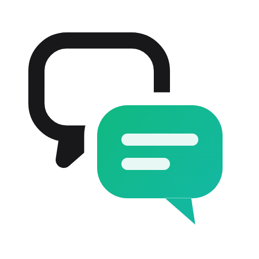
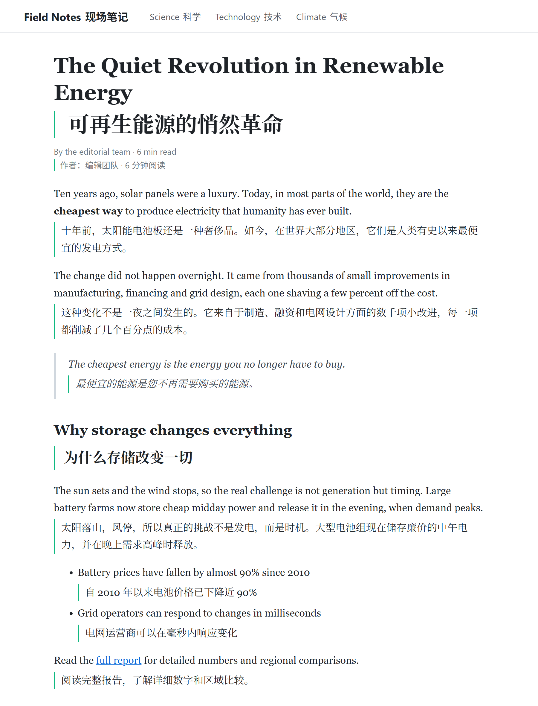
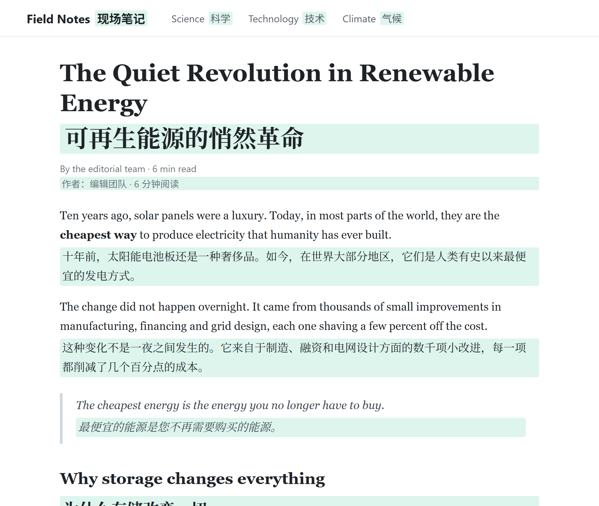
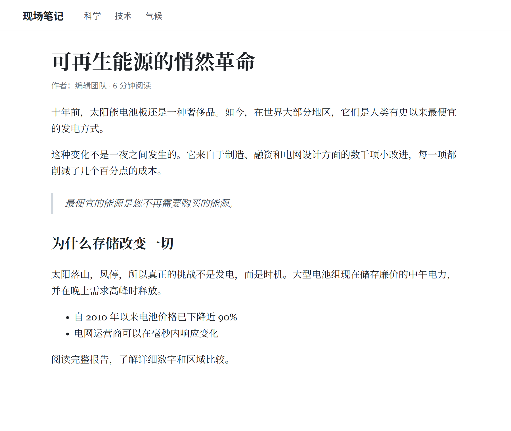
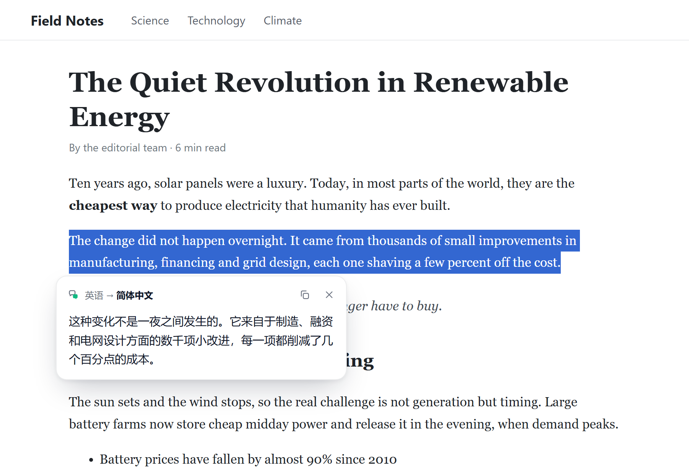
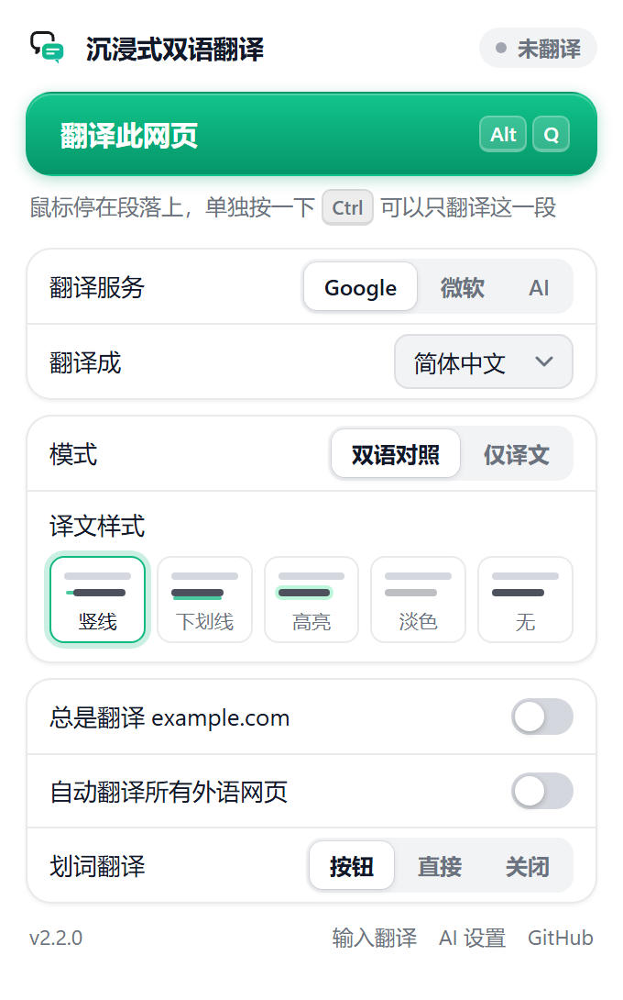
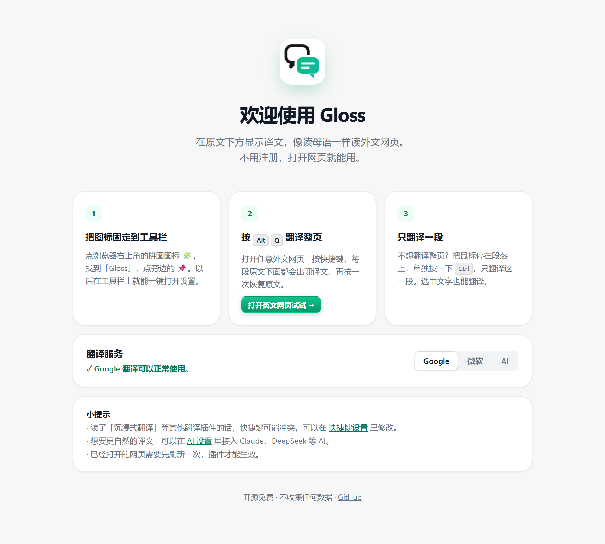
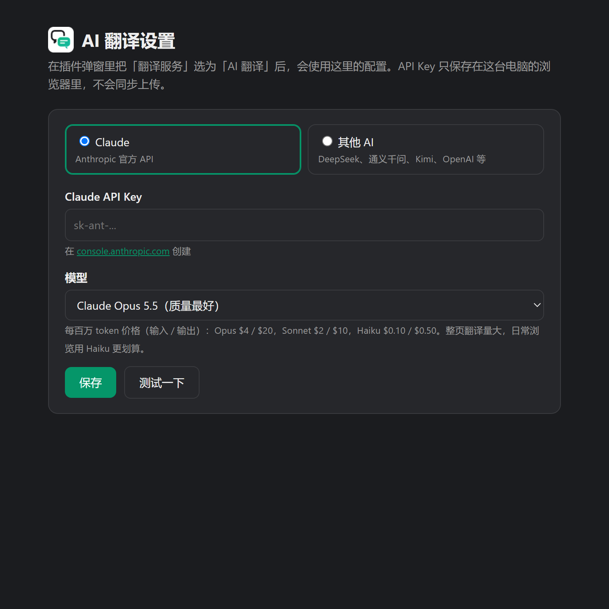
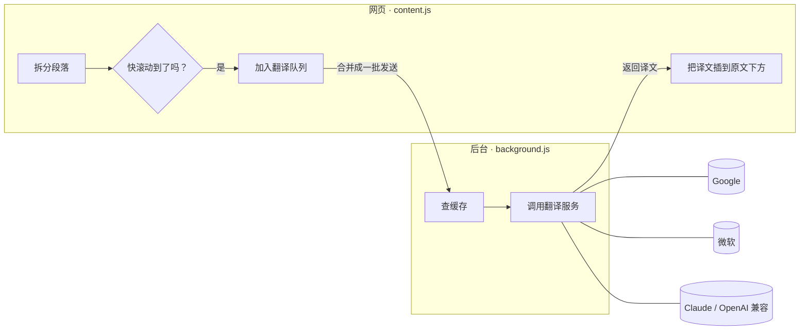

<div align="center">



# 沉浸式双语翻译

**在原文下方显示译文，像读母语一样读外文网页**

一个开源、免费、无需注册的 Chrome 双语翻译插件

[](CHANGELOG.md)
[](https://developer.chrome.com/docs/extensions/develop/migrate/what-is-mv3)
[](LICENSE)
[](#-项目结构)

[功能](#-功能) · [安装](#-安装) · [使用](#-使用) · [翻译服务](#-翻译服务) · [原理](#-实现原理) · [常见问题](#-常见问题) · [产品复盘](docs/PRODUCT.md)

<br />



</div>

<br />

## ✨ 功能

<table>
<tr>
<td width="50%" valign="top">

**📖 整页双语对照**
每段原文下方显示译文，标题、列表、引用、导航都能识别。按 <kbd>Alt</kbd> + <kbd>Q</kbd> 一键切换。

**🎯 只翻译一段**
鼠标停在段落上，单独按一下 <kbd>Ctrl</kbd>，只翻这一段；再按一次取消。

**✂️ 划词翻译**
选中文字，点出现的小按钮，弹出翻译卡片，显示原文语言，可以一键复制。

**🔁 仅译文模式**
不需要对照时，译文直接替换原文的位置。

**🧭 一分钟上手**
安装后自动打开欢迎页，3 步教会你怎么用。

</td>
<td width="50%" valign="top">

**⚡ 快而省**
只翻译屏幕附近的内容，多段合并成一次请求，翻过的句子有缓存。

**🔄 跟着网页变化翻译**
无限滚动、单页应用、展开的折叠内容，新出现的文字也会自动翻译。

**🤖 三种翻译服务**
Google、微软免费可用，**Google 连不上时自动切换到微软**；也可以接入 Claude、DeepSeek 等 AI。

**🎨 5 种译文样式 · 深色模式**
左侧竖线、虚线下划线、背景高亮、淡色、无样式，选之前就能看到效果。

**🟢 状态一目了然**
开着翻译的网页，工具栏图标上会显示绿色 ON 角标。

</td>
</tr>
</table>

## 📸 截图

| 背景高亮样式 | 仅译文模式 |
|:---:|:---:|
|  |  |

| 划词翻译 | 弹窗设置 |
|:---:|:---:|
|  |  |

| 欢迎页 | AI 设置 |
|:---:|:---:|
|  |  |

## 📦 安装

> 插件还没有上架 Chrome 应用商店，需要手动加载，大约 1 分钟。

1. 下载本仓库：点右上方绿色的 **Code** → **Download ZIP**，然后解压
2. 在 Chrome 地址栏打开 `chrome://extensions`
3. 打开右上角的 **开发者模式**
4. 点 **加载已解压的扩展程序**，选择解压出来的文件夹
5. 刷新要翻译的网页，按 <kbd>Alt</kbd> + <kbd>Q</kbd>

<details>
<summary><b>如何更新到新版本</b></summary>

<br />

下载新版本，覆盖原来的文件夹，然后在 `chrome://extensions` 里点插件卡片上的 **刷新** 按钮 ⟳。

如果你是用 `git clone` 下载的，运行 `git pull` 就能更新。

</details>

<details>
<summary><b>Edge、Brave、Arc 能用吗？</b></summary>

<br />

能。所有基于 Chromium 的浏览器都可以用同样的方法加载。Edge 的扩展管理页面是 `edge://extensions`。

</details>

## 🚀 使用

| 想做什么 | 怎么做 |
|---|---|
| 翻译整个网页 / 恢复原文 | <kbd>Alt</kbd> + <kbd>Q</kbd> · 点工具栏图标 →「翻译此网页」 · 网页空白处右键 |
| 只翻译一段 | 鼠标停在段落上，单独按一下 <kbd>Ctrl</kbd> |
| 划词翻译 | 选中文字 → 点「译」 |
| 输入文字翻译 | 工具栏图标 →「输入文字翻译」 |
| 打开某个网站时自动翻译 | 工具栏图标 → 勾选「总是翻译 xxx.com」 |
| 所有外语网页都自动翻译 | 工具栏图标 → 勾选「自动翻译所有外语网页」 |
| 修改快捷键 | 打开 `chrome://extensions/shortcuts` |

## 🌐 翻译服务

在工具栏弹窗里选择「翻译服务」：

| | 费用 | 速度 | 翻译质量 | 中国大陆 | 说明 |
|---|:---:|:---:|:---:|:---:|---|
| **Google 翻译** | 免费 | ⚡⚡⚡ | ★★★ | 需要 VPN | 默认。一次请求最多翻 50 段 |
| **微软翻译** | 免费 | ⚡⚡ | ★★★ | ✅ 能直接用 | 用的是必应翻译网页版的接口 |
| **AI 翻译** | 按用量付费 | ⚡ | ★★★★★ | 看服务商 | 会结合上下文，译文最自然 |

### 配置 AI 翻译

打开方式：工具栏弹窗 → **AI 设置**。

**Claude**：在 [console.anthropic.com](https://console.anthropic.com/settings/keys) 创建 API Key，然后选择模型：

| 模型 | 特点 | 价格（每百万 token，输入 / 输出） |
|---|---|---|
| Claude Opus 5.5 | 质量最好（默认） | $4 / $20 |
| Claude Sonnet 5.5 | 质量和速度平衡 | $2 / $10 |
| Claude Haiku 5.5 | 最快、最便宜，日常浏览推荐 | $0.10 / $0.50 |

**其他 AI**：任何兼容 OpenAI `/chat/completions` 接口的服务都可以用。DeepSeek、通义千问、Kimi、OpenAI 点一下就能填好接口地址。

填好后点 **测试一下**，确认能正常翻译。

## 🔧 实现原理



- **拆段落**：把每个块级元素（段落、标题、列表项等）里连续的文字、链接、加粗等内容当作一段；遇到嵌套的块级元素就断开，递归进去继续拆。一排紧挨着的导航链接会分别翻译
- **只翻译快要看到的内容**：用 `IntersectionObserver` 检测，提前 800px 开始翻译
- **新出现的内容**：用 `MutationObserver` 监听网页变化，有新内容就翻译
- **请求放在后台发送**：网页本身不能直接访问翻译接口，插件后台可以
- **AI 翻译**：每批 20 段，要求按 JSON 格式返回；如果返回的段数不对，会拆成两半重新翻译，保证每段对得上

## 🔒 隐私

- 没有服务器，不统计、不收集任何数据
- 要翻译的文字只会发给你选择的翻译服务（Google、微软，或你配置的 AI 接口）
- API Key 只保存在你这台电脑的浏览器里（`chrome.storage.local`），不会同步到别处
- 代码完全开源，没有任何第三方依赖

## ❓ 常见问题

<details>
<summary><b>按了 Alt+Q 没反应？</b></summary>

<br />

- 刚安装或刚更新插件时，**已经打开的网页要先刷新一次**。这时工具栏图标上会显示橙色的 **!**，打开弹窗点「刷新网页后即可翻译」就好
- `chrome://` 开头的页面和 Chrome 应用商店页面，浏览器不允许插件运行
- **快捷键被别的插件占用了**：比如「沉浸式翻译」默认用 <kbd>Alt</kbd> + <kbd>A</kbd>，所以我们改用了 <kbd>Alt</kbd> + <kbd>Q</kbd>。如果还是冲突，打开插件弹窗，主按钮上没有显示快捷键时，点「设置快捷键」换一个
- 从旧版本升级的用户：Chrome 只在第一次安装时设置快捷键，请到 `chrome://extensions/shortcuts` 手动改成 <kbd>Alt</kbd> + <kbd>Q</kbd>

</details>

<details>
<summary><b>显示「翻译失败」？</b></summary>

<br />

把鼠标移到红字上能看到具体原因，点一下会重试。常见原因：

- **Google 翻译**：所在网络访问不了 Google。插件会自动改用微软翻译，弹窗里也会提示你
- **微软翻译**：请求太频繁被暂时限制，等一会儿再试
- **AI 翻译**：API Key 不对或余额不足。在 AI 设置里点「测试一下」看具体报错

</details>

<details>
<summary><b>为什么有的段落没翻译？</b></summary>

<br />

下面这些内容会被故意跳过：已经是目标语言的段落、代码块、输入框，以及网页标记了 `translate="no"` 或 `notranslate` 的部分。

</details>

<details>
<summary><b>AI 翻译大概要花多少钱？</b></summary>

<br />

一篇 3000 词的英文文章，大约用 5 千输入 token、6 千输出 token。用 Claude Haiku 5.5 不到 ¥0.03，用 Opus 5.5 大约 ¥1。

</details>

## 📁 项目结构

```
├── manifest.json        插件配置：权限、快捷键、图标
├── background.js        后台：选择翻译服务、缓存、标签页开关、右键菜单
├── engines.js           三种翻译服务的实现（Google / 微软 / AI）
├── content.js           网页里：拆段落、整页翻译、Ctrl 单段翻译、划词气泡
├── content.css          译文样式
├── ui.css               弹窗、设置页、欢迎页共用的设计样式
├── popup.html / .js     工具栏弹窗
├── options.html / .js   AI 设置页
├── welcome.html / .js   安装后的欢迎页
├── icons/               插件图标
└── docs/                截图、logo，以及产品复盘 PRODUCT.md
```

纯原生 JavaScript，不需要构建，也没有任何依赖。改完代码在 `chrome://extensions` 点刷新就能看到效果。

## 🤝 参与贡献

欢迎提 [Issue](../../issues) 反馈问题或建议，也欢迎提交 Pull Request。

1. Fork 本仓库，新建分支：`git checkout -b feature/你的功能`
2. 修改代码，在 `chrome://extensions` 加载你的文件夹测试
3. 在 [CHANGELOG.md](CHANGELOG.md) 里写上你改了什么
4. 提交并发起 Pull Request

## 📝 更新日志

见 [CHANGELOG.md](CHANGELOG.md)。

## 📄 许可证

[MIT](LICENSE) © sovven

<div align="center">
<br />
<sub>如果这个插件对你有帮助，欢迎点一个 ⭐ Star</sub>
</div>
